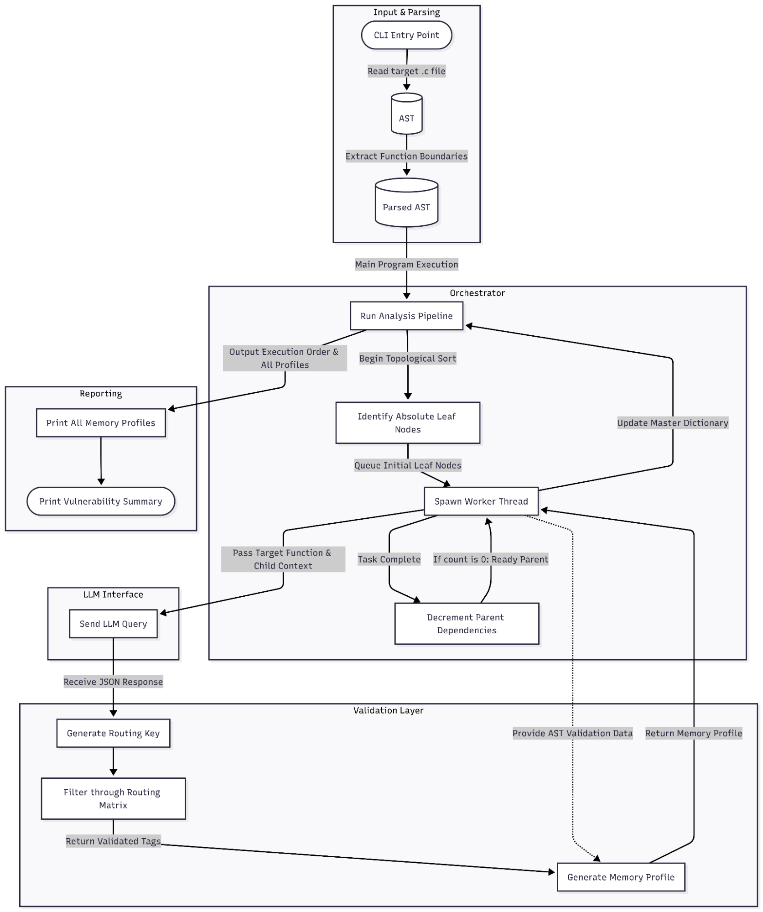

# Leak Logic Mapper


Leak Logic Mapper is an LLM-driven inter-procedural static analysis framework built to find memory leaks in C. In code analysis, an LLM will choke if it is tasked to analyse an entire codebase in a single prompt. Leak Logic Mapper solves this by performing compositional, bottom-up analysis of the call graph. It evaluates each function in isolation to construct a Memory Profile — a summary of which pointers that function allocates, frees, or returns — which is then supplied as context when analysing its callers. This keeps each prompt small while letting pointer ownership be tracked across deep call chains. To limit hallucinations, a validation layer parses source code into an AST and checks every identifier and function the LLM references against the symbols actually declared in the source. Claims that mention symbols which do not exist in the source code are discarded before they can propagate. The result is a highly scalable neuro-symbolic analyser.

## Academic Context
This framework was researched and developed as part of a final-year undergraduate dissertation at Manchester Metropolitan University. The full dissertation report is available in the `docs/` directory:
> **[Read Leak Logic Mapper: Technical Report (PDF)](https://github.com/jj-wallis/Leak-Logic-Mapper/raw/main/docs/Leak_Logic_Mapper_Technical_Report.pdf)**

---

## Architecture



AST parsing is performed with the tree-sitter-c Python library.

---

## Evaluation & Benchmarking

To evaluate Leak Logic Mapper, the framework was tested against a subset of the **Juliet Test Suite (CWE-401)** comprising **628 source files** and **2,614 individual functions**. 

*Note: The Juliet Test Suite is a public domain dataset provided by the National Institute of Standards and Technology (NIST) and the NSA Center for Assured Software.*

### Preventing Label Leakage
Standard Juliet test cases contain explicit textual hints (e.g., `/* POTENTIAL FLAW */` comments or function names like `_bad()` and `good1()`). To prevent the model from relying on these hints, `scripts/evaluate_juliet.py` passes all target code through a pre-processing sanitisation pipeline that:
* Strips all comments.
* Standardises function identifiers (anonymising vulnerabilities to `_target` and safe paths to `_variant`).

### Benchmark Results

All results below were obtained with gpt-4o via Azure OpenAI.

| Metric | Score / Count |
| :--- | :--- |
| **Evaluated Source Files** | 628 |
| **Total Functions Analysed** | 2,614 |
| **True Positives (TP)** | 626 |
| **True Negatives (TN)** | 1,734 |
| **False Positives (FP)** | 252 |
| **False Negatives (FN)** | 2 |
| **Precision** | **71.30%** |
| **Recall** | **99.68%** |
| **F1 Score** | **0.831** |

### Full Breakdown
For a comprehensive breakdown of the evaluation methodology and the exact data tables detailing all 628 test cases covered, please refer to section 5.7: Evaluation Metrics in the dissertation report.

---

## Prerequisites

* **Python 3.8+**
* **Git**
* **Ollama** *(Optional: Only required if running a local language model)*

---

## Installation & Setup

**1. Clone the Repository**

Open your terminal and clone the repository to your local machine:
```bash
git clone https://github.com/jj-wallis/Leak-Logic-Mapper
cd Leak-Logic-Mapper
```

**2. Create the Virtual Environment**

On Linux/macOS:
```bash
python3 -m venv .venv
source .venv/bin/activate
```

On Windows:
```cmd
python -m venv .venv
.venv\Scripts\activate
```

**3. Install Dependencies**

With the virtual environment active, install the required packages:
```bash
pip install -r requirements.txt
```

---

## Configuration

Leak Logic Mapper requires a `.env` file to manage backend settings and API keys. 

**1. Generate the Configuration File**

Run the following command to duplicate the template file. 

On Linux/macOS:
```bash
cp .env.example .env
```
On Windows:
```cmd
copy .env.example .env
```

**2. Choose Your Inference Engine**

Open the newly created `.env` file. You must configure **ONE** of the following three backends. Ignore the sections for the backends you are not using.

**Option A: OpenAI-Compatible API**

For OpenAI-compatible providers (e.g., OpenAI, Groq, OpenRouter).
1. Set the backend: `LLM_BACKEND=api`
2. Provide your key: `OPENAI_API_KEY=your_api_key_here`
3. Set your target model: `OPENAI_API_MODEL=your_model_here` 
4. Uncomment and set your base URL:
   `OPENAI_BASE_URL=https://api.your-provider.com/v1`

**Option B: Azure OpenAI**

For users routing through Microsoft Azure.
1. Set the backend: `LLM_BACKEND=api`
2. Provide your key: `OPENAI_API_KEY=your_api_key_here`
3. Set your target model: `OPENAI_API_MODEL=your_model_here` *(gpt-4o is suggested)*
4. Uncomment and provide your endpoint: `OPENAI_ENDPOINT=https://your-endpoint.openai.azure.com/`
5. Uncomment and ensure you are using the correct `OPENAI_API_VERSION` for your deployment.

**Option C: Local Hosted Model (Ollama)**

To run the analysis entirely offline using local hardware.
1. Ensure the Ollama background service is running on port 11434.
2. Pull your model: `ollama pull <model_name>` *(Note: The model must support JSON responses).*
3. Set the backend: `LLM_BACKEND=local`
4. Set the model name: `LOCAL_MODEL=<model_name>`

**Advanced System Settings (Optional)**

Depending on your hardware specifications or API rate limits, you can adjust the concurrency limits in the `.env` file:
*   `MAX_WORKERS`: Changes the maximum number of parallel threads. (Reduce this if hitting API rate limits or GPU memory constraints).

---

## Usage

Run the application by pointing it to a specific `.c` file:

```bash
python main.py [OPTIONS] <FILEPATH>
```

Run Leak Logic Mapper with the `-h` option to see a list of available CLI flags.

**Examples using Sample Test Cases**

A suite of sample C files is included in the `tests/sample_test_cases/` directory to verify the tool is operating correctly. To run a baseline test:

```bash
python main.py tests/sample_test_cases/01_basic_allocation_safe.c
```

---

## Current Limitations
* Inter-procedural analysis is restricted to a single `.c` file. Resolving dependencies across externally linked libraries is deferred as a preceding linker phase is not implemented.
* The system passes raw source code to the LLM without executing a preprocessor pass, meaning macros, typedefs and directives (e.g., `#ifdef`) are unresolved.
* The bottom-up topological sort requires a strictly acyclic call graph. Hence recursion is currently unsupported.

Please refer to section 3.9: System Scope (Minimum Viable Product Constraints) in the dissertation report for further information.

---

## License

This project is licensed under the MIT License — see the [LICENSE](LICENSE) file for details.
